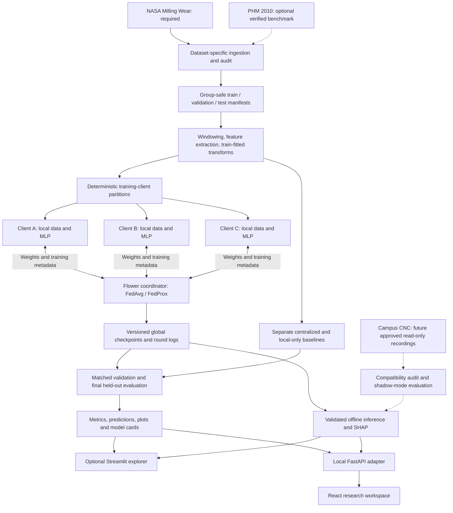

# FabFederate-CNC: Implementation Report and Project TODO

**Project:** Heterogeneity-aware, explainable federated learning for CNC milling-tool-wear estimation  
**Institution/context:** RV College of Engineering; Experiential Learning; SDG 9  
**Document date:** 4 November 2026  
**Status:** Required offline implementation completed and verified. Real NASA experiments, model artifacts, and results now exist; physical campus validation remains conditional. See [implementation evidence](results/findings.md) and [run instructions](../README.md).
**Primary architecture:** Revised campus/public-dataset architecture in [S1], especially Figure 1 on page 4 and module responsibilities on page 5.

## Contents

1. [Sources, precedence, and implementation status](#1-sources-precedence-and-implementation-status)
2. [Project purpose, scope, and research questions](#2-project-purpose-scope-and-research-questions)
3. [Datasets and acquisition plan](#3-datasets-and-acquisition-plan)
4. [Technology stack and tools](#4-technology-stack-and-tools)
5. [System architecture](#5-system-architecture)
6. [Data contracts and artifact storage](#6-data-contracts-and-artifact-storage)
7. [Data-engineering methodology](#7-data-engineering-methodology)
8. [Simulated clients and heterogeneity](#8-simulated-clients-and-heterogeneity)
9. [Models and federated-learning methodology](#9-models-and-federated-learning-methodology)
10. [Experiments, metrics, and reporting](#10-experiments-metrics-and-reporting)
11. [Explainability and operator dashboard](#11-explainability-and-operator-dashboard)
12. [End-to-end project workflows](#12-end-to-end-project-workflows)
13. [Proposed repository and configuration](#13-proposed-repository-and-configuration)
14. [Verification and quality gates](#14-verification-and-quality-gates)
15. [Risks, limitations, and decision rules](#15-risks-limitations-and-decision-rules)
16. [Project TODO list](#16-project-todo-list)
17. [Deliverables and definition of done](#17-deliverables-and-definition-of-done)
18. [Source traceability and research references](#18-source-traceability-and-research-references)

## 1. Sources, precedence, and implementation status

### 1.1 Source hierarchy

| Key | Supplied document | Role in this report |
|---|---|---|
| [S1] | `FabFederate_CNC_Revised_Campus_Dataset_Architecture.pdf`, 19 pages | Governing source for architecture, dataset roles, simulated clients, current hardware constraints, tools, research phases, and campus validation. |
| [S2] | `FabFederate_CNC_Comprehensive_Project_Report (1).pdf`, 17 pages | Supporting detail for data contracts, signal features, algorithms, evaluation, testing, and deliverables where consistent with S1. |
| [S3] | `Experiential Learning Phase -1 V Semester.pptx.pdf`, 18 PDF pages | Project motivation, objectives, literature framing, and the original technical methodology. |

The revised architecture takes precedence regardless of the order in which the files were attached. Page references in this document use PDF page positions; printed slide numbers can differ.

**Source-backed** means a requirement or recommendation stated in the PDFs. **Proposed implementation detail** means an engineering choice added here to make that plan executable. A proposal is not an implemented feature or an experimental finding. References cited inside the PDFs are reported as secondary citations here; their publications and dataset archives have not been independently verified for this document.

### 1.2 Reconciled decisions

| Topic | Decision for implementation | Source basis |
|---|---|---|
| Deployment context | Public-data research on a development computer; eventual supervised campus CNC testing. | S1, pp. 1-5 |
| External stakeholders | Peenya contacts and industry outreach from earlier material are not dependencies of the revised project. | S1, pp. 1-2; supersedes S2, pp. 3-4 and S3, pp. 10-11 |
| Primary dataset | NASA PCoE Milling Wear. | S1, p. 6 |
| Additional dataset | PHM 2010 is optional after access/schema/labels are verified. | S1, p. 6 |
| Initial clients | Three logical, disjoint public-data partitions on one computer; five only if independent groups support them. | S1, pp. 4, 8 |
| Main prediction task | Continuous measured flank-wear regression, preferably VB in its documented units. | S1, pp. 2, 6, 8 |
| Primary FL model | Small PyTorch MLP on a consistent engineered feature vector. | S1, pp. 5, 8-9 |
| FL comparison | FedAvg and FedProx in the full research scope. FedAvg is the first functioning milestone; FedProx follows. | S1, pp. 10, 15, 17; resolves optional treatment in S2/S3 |
| Main UI | Local React workspace and FastAPI adapter; the original Streamlit explorer remains available under `dashboard/`. | Streamlit: S1, pp. 12-14; React/API: subsequent explicit user request |
| Test-set policy | Validation during model selection; final test after choices are frozen. | S1, p. 15 and S2, pp. 9, 12; resolves S1 p. 10's broader wording about periodic held-out evaluation |
| Operator action | Human inspection or re-measurement support. | S1, p. 10 |

### 1.3 What currently exists

At planning time the workspace contained only the three source PDFs and this report. The implementation now includes audited NASA acquisition, data preparation, all required baselines, Flower FedAvg/FedProx, five scenarios, three seeds, SHAP, the React/FastAPI workspace, an optional Streamlit explorer, locked dependencies, and verified research artifacts. All required offline tasks T01-T26 are complete. Fresh-process reproduction matches 4,905 saved predictions exactly. The later user-requested React/API extension and repository migration are covered by additional regression tests. Results and limitations are recorded in [scientific findings](results/findings.md). No campus recordings or approvals have been supplied.

## 2. Project purpose, scope, and research questions

### 2.1 Problem and intended output

CNC milling-tool wear can affect machining quality and process reliability. FabFederate-CNC studies whether models trained collaboratively across small, different data partitions can estimate measured tool wear usefully and explain their predictions. Its immediate output is a reproducible research prototype that reads recorded signals or verified features, estimates wear, and shows the inputs that influenced that estimate. [S1, pp. 1-3; S2, pp. 2-3; S3, pp. 4-9]

The central comparison is:

> On the same leakage-safe benchmark, how do local-only models, centralized training, FedAvg, and FedProx differ in wear-estimation error, worst-client performance, communication cost, and explanation stability?

### 2.2 Research questions

1. Does FedAvg help a client with few labeled machining runs compared with isolated training?
2. Does FedProx improve accuracy or stability under explicitly constructed non-IID partitions?
3. How large is the gap between federated and centralized training on the same eligible training data?
4. Do influential features and their attributions remain consistent across seeds, clients, and held-out runs?
5. Can the offline model later be evaluated on read-only campus CNC data with measured wear labels?

These are questions to test. FL improvement, operator acceptance, manufacturing savings, and successful public-to-campus transfer are not assumed outcomes. [S1, p. 3]

### 2.3 Scope boundaries

**Required for the complete offline study:** NASA audit; validated wear labels; grouped splits; engineered features; mean/median, Random Forest, centralized MLP and local MLP baselines; Flower FedAvg/FedProx simulation; feasible heterogeneity scenarios; repeated-seed evaluation; SHAP; Streamlit; versioned artifacts; reproducibility and correctness checks.

**Conditional extensions:** PHM 2010, FFT/wavelet features, a waveform 1D-CNN, wear-stage classification, and a supervised campus pilot. Each needs its own feasibility evidence. [S1, pp. 6-17]

The initial system has no autonomous CNC control, live industrial network, automatic tool replacement, required cloud infrastructure, or remaining-useful-life prediction. Plain model aggregation also provides no formal privacy guarantee. [S1, pp. 18-19]

## 3. Datasets and acquisition plan

### 3.1 Complete dataset inventory

| Dataset/data category | Status | Planned role | Admission condition |
|---|---|---|---|
| NASA PCoE Milling Wear / Milling Data Set | Required; not supplied | Primary supervised wear-regression benchmark and source of initial client partitions. | Obtain source archive; verify access terms, file integrity, grouping, signals, target units, and label timing. |
| PHM 2010 Milling | Optional; not supplied | Separate second benchmark, held-out-cutter experiments, and potential domain comparison. | Verify official access, license, actual fields, independent groups, and measured flank-wear mapping. |
| Campus CNC recordings and measured wear | Future; unavailable under S1 | Supervised shadow-mode validation and distribution-shift analysis. | Approved access, supported read-only capture, calibrated measurements, synchronized identifiers, and compatible inputs. |
| MATWI | Literature reference only | Context for the CNC FL study discussed in S1; possible later extension. | Explicit scope decision plus verified access, labels, schema, and terms. It does not replace NASA by default. |
| C-MAPSS / FedCMAPSS-related benchmark | Methodology reference only | Ideas for heterogeneity tasks, repeatability, and per-client reporting. | Outside the present wear-regression dataset plan; its RUL task is different. |
| Derived simulated-client partitions | Required generated artifacts | IID-ish, condition-skew, quantity-skew, label-skew, and few-shot experiments where feasible. | Deterministic assignments of existing independent groups, with no train/test overlap. |
| Perturbed evaluation copies | Conditional generated artifacts | Noise and missing-channel robustness tests. | Preserve original data and label provenance; record perturbations and evaluate separately. |

Source basis: S1, pp. 2, 6-8, 15-16, 19. Earlier Peenya shop data and multi-site industrial data in S2 are superseded as acquisition requirements by S1. They are not additional datasets promised for this implementation.

### 3.2 NASA PCoE Milling Wear: primary dataset plan

**Purpose:** Learn a mapping from available machining signals and operating context to measured insert/tool flank wear. Use it to establish every required offline experiment before adding another source. [S1, p. 6]

**Acquisition reference:** The comprehensive report records the [NASA Milling Wear catalogue link](https://data.nasa.gov/dataset/milling-wear). This is a supplied reference, not an independently checked download location. Save the actual authoritative catalogue and archive URLs at acquisition time. S1 also identifies NASA's Prognostics Data Repository and attributes the dataset to Agogino and Goebel (2007). [S1, p. 19; S2, p. 16]

| Item | Planned treatment |
|---|---|
| Raw representation | Inspect archive contents first. Support MATLAB `.mat` if present; select the reader after checking the actual format/version. |
| Prediction target | Documented measured VB or another explicitly defined continuous wear measurement. Keep original units in reported errors. |
| Signals | Inventory only channels present in the obtained archive. Vibration, force, current, and acoustic-emission signals are candidate examples from the source material, not a verified channel list. |
| Process metadata | Preserve speed, feed, depth of cut, material, operation, cutter/tool ID, and timestamps only where available and documented. |
| Independent units | Establish the relationship among experiment/case, physical cutter, run, cut, and signal segment before selecting the split key. |
| Label alignment | Record exactly when wear was measured and which recorded operation it describes. Do not interpolate new ground truth silently. |
| Development use | Raw signal/metadata audit, feature extraction, fixed grouped splits, baselines, client simulation, FL, SHAP, and dashboard examples. |
| Known limitation | Many windows can come from few independent experiments. Report both counts and preserve dependence during splitting and uncertainty estimation. |

**Not yet verified:** archive version, file names, exact experiment/cutter/run counts, sensor channels, sampling frequencies, dimensions, wear-measurement frequency, missing labels, label units, and redistribution terms. The PDFs explicitly require this audit; they do not establish these facts. [S1, pp. 6-7]

**Loader acceptance:** Every accepted feature window can be traced back to a source file, an independent group, a verified label mapping, and a declared unit. Missing measurements remain missing. Records without suitable labels may support exploration but cannot enter supervised training or accuracy calculations.

### 3.3 PHM 2010 Milling: optional second benchmark

**Purpose:** Test the same methodology on an independently audited milling dataset, especially held-out-cutter generalization. This is a separate experimental extension and is not required for the NASA-based prototype. [S1, pp. 6, 15]

Before implementation, verify the official distributor/archive, access conditions, citation, file format, tool/run identifiers, signal channels and sampling rates, wear measurement schema, and which subsets actually have released ground truth. Do not assume every challenge/test file is labeled.

If wear is measured on multiple cutting edges, preserve all measurements. Any conversion to one target, such as mean or maximum edge wear, is a **proposed task-definition choice** that must be documented and applied consistently. Unknown or unreleased labels cannot be replaced with predictions and treated as measured truth.

**Proposed integration rule:** Start with a dedicated `phm_loader.py`, dataset card, feature schema, split manifest, and result table. Do not concatenate NASA and PHM rows by column position. A pooled or transfer experiment requires a documented common set of signals, compatible units, target semantics, and a separately declared evaluation protocol.

### 3.4 Campus CNC data: later validation dataset

S1 states that campus hardware is planned but presently unavailable. Consequently there are no verified campus sample counts, signals, controller protocols, calibration records, or wear labels. [S1, pp. 1, 6, 15-16]

The future data package should contain:

- Supervisor-approved source/controller/sensor identification and permissible read-only acquisition method.
- Recorded signals or exports, original units, sampling frequency, timestamp meaning, and calibration information.
- Dataset/run/tool identifiers and available machining context.
- Wear measurements with measurement time, instrument/procedure, units, and qualified supervision.
- Signal-to-label alignment, data-quality exclusions, provenance, and access/retention conditions.

First compare campus input distributions with benchmark inputs and test preprocessing parity. If labels exist, evaluate the frozen public-data model on campus recordings before any adaptation. If adaptation is later attempted, reserve separate campus training/validation/test groups. Without labels, report only input compatibility and distribution shift; accuracy and validated wear prediction remain unmeasured.

One campus machine provides a domain-validation opportunity. It does not establish a multi-site federated deployment. [S1, p. 16]

### 3.5 Literature-only datasets and derived data

S1 describes MATWI as the dataset used in Khan et al. (2026), while FedCMAPSS is a reference for a different RUL task. Their role here is methodological context. No MATWI or C-MAPSS training dependency is introduced. [S1, pp. 2, 6, 19]

Simulated clients are named subsets of an audited public dataset. They do not create new machines, factories, independently measured wear labels, or evidence of field performance. Noise/missingness copies are stress-test inputs, not additional collected data. [S1, pp. 8, 15]

### 3.6 Dataset card and provenance requirements

Create a separate dataset card for each admitted source. It must record:

1. Dataset name/version, authoritative source URL, citation, acquisition date, license/terms, archive SHA-256, and original directory structure.
2. File inventory, parser version, corrupt/missing records, exclusions, and reasons.
3. The experiment/tool/run hierarchy and count of independent groups versus generated windows.
4. Channel names, units, sampling rate, timestamp semantics, valid ranges, missingness, and calibration information where supplied.
5. Wear target definition, units, timing, multi-edge policy if relevant, missing-label rules, and alignment examples checked against the source.
6. Available machining settings, categorical encodings, known confounders, and input fields available at inference.
7. Split feasibility, frozen group manifests, client assignments, preprocessing version, and limitations.
8. Whether files may be redistributed or must be retrieved independently.

This checklist is a prerequisite to finalizing preprocessing, not a statement that these items have already been verified. [S1, p. 6; S2, pp. 4-5]

## 4. Technology stack and tools

The stack below follows the revised source recommendations. Versions must be selected, compatibility-tested, and locked during bootstrap; a library version mentioned in a paper is not automatically the project's dependency version. [S1, pp. 2, 12]

| Layer | Initial selection from sources | Responsibility | Status/notes |
|---|---|---|---|
| Language/runtime | Python 3.11+ | Data, modeling, FL, evaluation, and UI. | Required; lock one compatible Python version. |
| Environment | `uv` or `pip` + `venv` | Isolated installation and reproducible dependencies. | Choose one workflow and document it. |
| Arrays/tables | NumPy, pandas | Signal arrays, manifests, features, and result tables. | Required. |
| Scientific processing | SciPy | Supported MATLAB loading, statistics, filtering, and FFT. | Reader suitability depends on audited file format. |
| Parquet support | `pyarrow` | Persist typed feature/metric tables. | Proposed supporting dependency when using Parquet; CSV is a simpler fallback. |
| Classical ML | scikit-learn | Random Forest, optional ridge baseline, preprocessing, grouped splitting, and metrics. | Required. |
| Neural model | PyTorch | Shared MLP, local training, inference, and proximal loss. | Required for the FL study. |
| Federation | Flower simulation | Logical clients, global model distribution, sample-weighted aggregation, and round coordination. | Primary FL implementation; use a compatible simulation setup. |
| Explanations | SHAP | Feature attributions on the actual selected predictive model. | Required; bound background/sample count for laptop runtime. |
| Plots | Matplotlib; seaborn or Plotly as useful | Research figures and dashboard charts. | Choose only what each view needs. |
| Frontend | React, TypeScript, Vite, Tailwind, shadcn conventions, Motion, Lucide | Local saved-study exploration and model inference. | Implemented subsequent user-requested interface. |
| Backend API | FastAPI, Pydantic, Uvicorn | Read completed studies and validate prediction inputs. | Local loopback adapter, no training/control endpoints. |
| Research explorer | Streamlit | Data exploration, comparisons, inference, and explanations. | Original offline demonstration, retained under `dashboard/`. |
| Experiment tracking | JSON/JSONL + CSV/Parquet + Git | Configurations, seeds, metrics, versions, and provenance. | Lightweight initial choice supported by S1. |
| Checkpoints | PyTorch checkpoint or safetensors; JSON schema | Save model parameters and compatible input metadata. | Select one model format; load trusted project artifacts. |
| Tests/style | pytest, Ruff | Correctness checks and maintainable Python. | Required development tools. |
| CI | GitHub Actions | Run appropriate small checks after a repository is configured. | Source-recommended; CI must not require redistribution of restricted archives. |
| Hardware | Standard development laptop; CPU first | Data preparation, three simulated clients, and demo. | GPU and remote server are not prerequisites; measure actual resource use. |

**Conditional tools:** PyWavelets for wavelet ablation; MLflow for larger experiment tracking; SQLite for local history; Docker for reproducible packaging; remote multi-user services only after a separate scope decision. The local FastAPI/React interface was added by explicit user request; it does not imply multi-user deployment. XGBoost, a CNN, or an LSTM must earn their addition through a defined experiment. [S1, pp. 8, 12; S2, pp. 10-11, 16]

**Future hardware integration:** Read-only CSV or OPC-UA acquisition only when the actual controller/export capabilities support it and campus access is approved. PostgreSQL, MongoDB, Kubernetes, MQTT, paid cloud services, physical edge nodes, and a GPU server are outside the initial dependency set. [S1, p. 12]

## 5. System architecture

### 5.1 Governing architecture

The following diagram restates **S1, Figure 1, page 4**, with downstream evaluation and UI responsibilities from S1, page 5. Every current training component can run on the same computer. The clients represent logical data silos, not physical CNC machines.



The flow is: audited recordings -> frozen independent-group splits -> features and reproducible client partitions -> local training and parameter exchange -> saved global model -> evaluation and explanations -> offline dashboard. Campus recordings join only through a later compatibility gate.

### 5.2 Module responsibilities

| Module | Inputs | Responsibilities | Outputs |
|---|---|---|---|
| Dataset adapters | Original archives and dataset card | Decode source-specific files, identifiers, units, and labels; reject invalid records. | Normalized signals, run manifest, audit report. |
| Split/partition manager | Independent groups and available metadata | Freeze train/validation/test boundaries; create feasible client scenarios deterministically. | Split and client manifests with hashes. |
| Feature pipeline | Approved runs, channel schema, label map | Segment, compute features, apply train-fitted transformations, preserve provenance. | Model-ready feature tables and preprocessing bundle. |
| Baseline trainer | Eligible training features | Fit trivial/RF/central MLP and one local MLP per client. | Models, training/validation logs. |
| FL client | Its own training partition and global weights | Train identical MLP locally; apply proximal term for FedProx. | Updated parameters, actual training count, loss, duration. |
| Flower coordinator | Client updates and run configuration | Validate compatibility, aggregate, version checkpoints, log rounds and payload sizes. | Global model and round history. |
| Evaluator | Frozen model, designated split, metadata | Compare methods on the same held-out groups; summarize client/run errors and costs. | Reproducible metric/prediction tables and plots. |
| Explainer/inference | Validated input and selected model bundle | Apply matching preprocessing, predict, compute model-specific attributions. | Wear estimate, quality status, explanation, provenance. |
| Streamlit app | Versioned local artifacts or approved input files | Present dataset, experiments, client differences, convergence, and inference. | Read-only research and operator views. |
| Local API and React | Trusted completed study artifacts and validated feature rows | Expose saved evidence and compute selected-model estimates. | Local research UI; no training or control endpoints. |
| Future campus adapter | Approved recorded exports and measurements | Check signal/target compatibility and domain shift. | Campus validation records; no control commands. |

Source basis: S1, pp. 5, 13-14; S2, pp. 5, 7, 9-12.

### 5.3 Data movement and isolation

In the **FL training path**, feature rows and raw signals remain within each client partition. The coordinator handles model parameters, counts, scalar training metadata, and checkpoint references. A separate evaluator may read permitted public held-out data for research metrics. Centralized training intentionally pools eligible public training partitions as a comparison experiment; it is a separate data-access mode. [S1, pp. 5, 10, 15; S2, pp. 7, 12, 14]

A one-computer simulation demonstrates algorithm behavior and software-level separation. It does not demonstrate independently administered data custody. Logs and tests must check actual payloads; merely calling a process a client proves no privacy property.

Model updates can reveal information. Secure aggregation and differential privacy are outside the initial implementation. Network authentication, TLS, and remote transport become relevant only for a separately approved physical multi-node extension. [S1, pp. 10, 18]

## 6. Data contracts and artifact storage

These are **proposed internal contracts**, expanded from S1, p. 13 and S2, p. 5. They describe normalized project records, not original NASA or PHM columns.

| Contract | Required contents and guarantees |
|---|---|
| Dataset manifest | `dataset_id`, source/version/terms, archive/file SHA-256, parser version, acquisition date, exclusions. |
| Run manifest | `dataset_id`, `run_id`, `independent_group_id`, optional `tool_id`, available settings, channel references, label source/time/units. |
| Feature row | `dataset_id`, `run_id`, optional `tool_id`, `window_id`, sample/time boundaries, `feature_schema_version`, ordered numeric features, nullable `wear_target`, `wear_unit`, `split`, optional `client_id`. |
| Split manifest | Split version/hash, grouping rule, seed, complete group IDs in train/validation/test, exclusion policy. |
| Client partition | Scenario, seed, `client_id`, disjoint training groups, feature schema hash, row/run counts, held-out domain association where feasible. |
| Client update | Round, client ID, model/schema version, actual training example count, named/ordered compatible parameters or reference, training loss, duration, serialized bytes. |
| Evaluation record | Run ID, dataset/split/partition hashes, seed, method, hyperparameters, `mu`, checkpoint, split, group/client, metrics and counts. |
| Prediction record | Source ID, model and preprocessing versions, schema, estimated wear and units, optional measured wear, input-quality status, SHAP reference, inspection-policy version. |
| Campus record | Source/run/tool ID, units, timestamps, sampling rate, calibration/measurement quality, approval/access metadata. |

Metadata fields, labels, target timestamps, split/client IDs, run/tool IDs, and source identifiers are excluded from the model input vector. Available machining settings may enter only through an explicit feature allowlist. This prevents convenient identifiers from becoming target proxies.

### 6.1 Local persistence

- `data/raw/`: preserve original archives/files; treat them as immutable.
- `data/interim/`: decoded arrays, aligned label maps, and audit outputs.
- `data/processed/`: versioned feature tables with row provenance.
- `data/splits/`: split/client manifests and hashes.
- `artifacts/experiments/`: complete versioned studies, including configuration snapshots, prepared-data snapshots, models, metrics, logs and figures.
- `artifacts/inference/`: feature examples, file predictions and explanations.

Git stores code, approved metadata, small safe fixtures, configuration, and retrieval instructions. Ignore raw datasets, large derived data, checkpoints, secrets, and any restricted future campus recordings. Dataset terms govern redistribution. [S1, p. 13; S2, p. 11]

### 6.2 Model bundle

A usable model bundle must include weights/model artifact; model architecture; ordered feature names; units; preprocessing/imputation state; dataset/split/feature hashes; training configuration and seed; validation selection record; model card; and any supported inspection policy. Prediction must fail clearly on schema/version mismatch rather than guess feature order.

## 7. Data-engineering methodology

### 7.1 Audit and normalize the source

1. Acquire the authoritative dataset and preserve its source metadata and checksums.
2. Inventory each file; inspect a small number of decoded examples manually before bulk processing.
3. Establish the actual experiment/tool/run/cut hierarchy and documented wear-measurement timing.
4. Validate numeric types, units, finite values, missingness, channel lengths, and sampling information.
5. Write exclusions and unresolved source ambiguities to an audit report. Avoid converting unknown values into plausible defaults.

### 7.2 Freeze group boundaries before window generation

Use the strongest valid independent group available. If repeated runs share the same physical cutter, prefer cutter-level separation for a cross-tool claim. If only run grouping is supported, hold out complete runs and describe the more limited generalization claim. If repeated measurements belong to the same experiment, keep that family together. [S1, pp. 6-8, 15]

**Proposed split procedure:** Inventory groups and their conditions; reserve a fixed final test set; reserve validation groups from the remainder; assign the remaining training groups to clients. Save all IDs, rules, and seeds. Select ratios only after seeing the number of independent groups; a nominal percentage is not a substitute for viable validation/test coverage.

Deterministic per-run feature extraction can be cached after these assignments. Fit imputation, scaling, feature selection, model settings, and decision thresholds using their permitted training/validation data only. Test measurements never guide preprocessing or hyperparameter selection.

### 7.3 Align measured wear with recorded signals

For each signal record, store the label's source and timing. Distinguish wear measured before a cut, after a cut, and at a less frequent interval. Define whether the task estimates wear associated with a completed recorded operation; do not describe it as forecasting future failure.

When only run-level wear exists, multiple windows may share that measured value. Report the number of distinct measurements and independent groups as well as windows. Do not create wear progression by interpolating labels without an explicit, justified alternate experiment. Do not use future measurements or unavailable historical wear as inference features. [S1, p. 6]

### 7.4 Windowing and signal quality

Window length, stride, transient trimming, overlap, filtering, and minimum valid-sample rules are **proposed tunable preprocessing settings**. Set them from the audited sampling rate and physical recording context, using training/validation data. Record both samples and seconds where conversion is possible.

Windows never cross independent runs. Overlapping windows remain in the same split. Flag clipping, missing channels, nonfinite values, and insufficient duration. Remove or impute only under a documented rule that can also run at inference. Filtering must preserve relevant signal behavior and be recorded as part of the feature version. [S1, pp. 6-7; S2, pp. 5-6]

### 7.5 Feature engineering

| Feature family | Initial candidates | Requirements and cautions |
|---|---|---|
| Time domain | Mean, RMS, standard deviation, variance, peak-to-peak, kurtosis. | Primary feature set from S1. Compute per available channel; document exact definitions. |
| Additional statistics | Peak, crest factor, skewness. | Supported candidates from S2; handle zero denominators and short/constant windows. |
| Frequency domain | FFT band power, dominant frequency, spectral centroid. | Optional ablation; requires verified sampling frequency and justified band definitions. |
| Wavelet | Chosen sub-band summaries/energies. | Optional measured ablation; record wavelet, decomposition level, and boundary handling. |
| Machining context | Verified speed, feed, depth, and material/operation encoding. | Include only fields present and available at prediction time. |
| Quality metadata | Valid-sample fraction, clipping, channel coverage. | Initially used for validation/abstention; any use as model inputs must be explicit. |

For a signal window `s[1..N]`, RMS is `sqrt(sum(s[i]^2)/N)`, mean is `sum(s[i])/N`, and peak-to-peak is `max(s)-min(s)`. Document population/sample variance and excess/non-excess kurtosis conventions so cached and inference features agree.

Signal magnitude may contain wear information. Compare amplitude-preserving processing with normalization choices rather than automatically normalizing every waveform to unit energy. [S1, pp. 2, 7; S2, p. 6]

### 7.6 Consistent preprocessing across federated clients

All clients need the same ordered feature schema and compatible input coordinates for parameter averaging. A single run must not silently mix unrelated client-specific feature orderings or transformations.

**Proposed initial public-benchmark policy:** Fit one common imputer/scaler using only the allowed pooled public training partition during benchmark preparation; freeze it and give the same transform to centralized, local-only, FedAvg, and FedProx MLPs. Keep the Random Forest pipeline separately documented. This isolates the training-algorithm comparison and avoids mismatched scaling.

This policy uses pooled public training data during preprocessing and must be disclosed. The FL coordinator still receives no training rows during federated rounds, but the overall preparation process does not demonstrate private preprocessing across independent owners. A physical multi-site extension would need a separately designed and evaluated shared or federated preprocessing policy. Do not silently change to per-client fitted scalers and treat it as the identical experiment. [S2, p. 6 supports declaring local versus common scaling; exact initial policy proposed here.]

### 7.7 Cache and audit

Persist feature schema, source hashes, label mappings, split assignments, preprocessing parameters, and extraction code/config version with each table. Rebuilding the same data with the same versions and seed should preserve group membership and feature definitions. Every exclusion must be countable and traceable.

## 8. Simulated clients and heterogeneity

Begin with three clients. Increase to five only when each configuration has sufficient disjoint independent groups and meaningful held-out coverage. A scenario that the dataset cannot support is recorded as infeasible. [S1, p. 8]

| Scenario | Construction | Fixed comparison/question |
|---|---|---|
| IID-ish reference | Approximately balance complete training groups across clients by available condition and wear coverage. | Cost and behavior of federation without deliberately strong skew. |
| Condition/domain skew | Assign complete groups by verified speed/feed/depth regime, material, or tool family. | Generalization across differing machining conditions. |
| Quantity skew | Allocate unequal numbers of complete training groups. | Influence of client data volume and sample-weighted aggregation. |
| Label skew | Allocate training groups with differing measured-wear distributions. | Sensitivity to unequal wear-stage coverage; no split-boundary crossing. |
| Few-shot/limited labels | Restrict one client's labeled training groups while retaining the predefined evaluation sets. | Whether collaboration helps or harms a low-data client. |

Only training groups are allocated to training clients. When a client/domain has corresponding held-out groups, record that association independently for client-wise evaluation. If there is no defensible client-specific held-out set, say so and report the supported pooled/group results instead of inventing per-client coverage.

**Proposed reporting policy:** Persist both training-window count and independent-run count. FedAvg uses the number of eligible local training examples contributing to the update, as defined in the run configuration; do not multiply that count by local epochs or repeated batch visits. Equal-run weighting is a separate optional ablation because overlapping windows and different run lengths can change effective weights.

Use 3-5 seeds where feasible, report actual repetitions, and save every partition. For fixed-split training-seed comparisons, keep splits unchanged. If partition seeds are varied, label that additional source of variation. Noise and missing-channel tests are distinct robustness experiments with the same input contract or a clear rejection path. [S1, pp. 8, 15]

## 9. Models and federated-learning methodology

### 9.1 Baseline sequence

| Model | Training access | Purpose |
|---|---|---|
| Mean/median predictor | Eligible training labels for the relevant comparison. | Sanity check and no-learning reference. |
| RandomForestRegressor | Pooled public training rows; optionally one RF per client. | Strong compact feature-based baseline; source recommendation. |
| Ridge regression | Same permitted feature data. | Optional simple comparator from S2. |
| Centralized MLP | Union of eligible client training partitions. | Matched neural reference; not guaranteed to be an upper bound. |
| Local-only MLPs | One client's training rows per model. | Isolated learning reference, especially for limited-label clients. |
| FedAvg MLP | Same training union distributed across clients. | Required federated baseline. |
| FedProx MLP | Identical partitions/model with a changed local objective. | Required full-study heterogeneity comparison. |

Random Forest trees are not directly averaged using standard neural FedAvg. Keep them as non-federated references. A 1D-CNN requires sufficient audited waveforms and independent groups; it is an optional later model, not the initial implementation. [S1, pp. 8-10]

### 9.2 Shared MLP: proposed starting configuration

These settings are explicitly starting values in S1, p. 8; they are not validated optima.

| Setting | Initial configuration |
|---|---|
| Input | Fixed ordered numeric feature vector, dimension determined by audited schema. |
| Architecture | `input -> 64 -> 32 -> 1`, ReLU hidden activations, dropout 0.1. |
| Output | One continuous wear estimate. |
| Optimizer | Adam, learning rate 0.001. |
| Batch size | 32, subject to available training rows. |
| Local epochs | 3 per round initially. |
| Federated rounds | 30-50 pilot rounds; fixed validation-based selection protocol. |
| Loss | Choose and record MSE or Huber; keep it matched across neural comparisons. |
| Participation | Full participation initially. |
| Seeds | 3-5 where feasible; seed model initialization, shuffling, and scenario generation explicitly. |

**Proposed comparison policy:** For each seed, initialize the same shared architecture consistently and declare the optimizer-state policy. Initially reset client optimizer state at each round in both FL algorithms; if persistent state is studied, treat it as a distinct configuration. Log centralized/local training budgets rather than implying they match FL computation automatically.

### 9.3 FedAvg

At communication round `t`, the coordinator sends global parameters `w_t` to participating clients `S_t`. Client `k` trains locally and returns parameters `w_(t+1,k)` plus actual training-example count `n_k`. Aggregate:

```text
w_(t+1) = sum over k in S_t [n_k / sum over j in S_t(n_j)] * w_(t+1,k)
```

Validate parameter names/shapes/dtypes, finite values, positive counts, and model/feature versions before aggregation. Never include validation or test rows in `n_k`, and do not count the same local example again for every epoch. If a client fails, log the failure and the declared round policy rather than silently changing the participating population. [S1, p. 10; validation mechanics proposed here.]

### 9.4 FedProx

Use the same coordinator, compatible parameter averaging, client participation, and data as FedAvg. Change the client's local objective:

```text
local objective = F_k(w) + (mu / 2) * sum over parameters ||w - w_t||^2
```

`w_t` is a fixed snapshot of the incoming global parameters for that round; gradients update the local model, not the snapshot. `F_k` is the same prediction loss used in the matched FedAvg run. Log the proximal term separately where practical.

FedProx does **not** select the lowest-scoring client. It regularizes local optimization to limit drift. [S1, p. 10]

**Proposed pilot grid:** `mu = [0, 0.001, 0.01, 0.1]`, adjusted only through a documented validation protocol. This exact grid is an implementation proposal, not a prescribed value from the sources. With otherwise identical implementation, `mu=0` should reduce to the unregularized local objective; deterministic toy checks should verify this.

### 9.5 Federated training loop

```text
load frozen experiment config, dataset/split/client hashes, and feature schema
initialize global model with recorded seed
for each configured round:
    choose clients using the declared participation policy
    send global weights and round configuration
    for each participating client:
        load only its training rows and common preprocessing bundle
        train identical local MLP for the configured local epochs
        add proximal penalty only in the FedProx configuration
        return compatible parameters, training count, and scalar metadata
    validate updates and sample-weight-average successful accepted updates
    save checkpoint and record time, counts, failures, and payload sizes
    evaluate on the designated validation schedule
select model/checkpoint using validation only
evaluate the frozen selection on the untouched final test groups
```

Round curves use training/validation metrics. A test curve inspected repeatedly during tuning would weaken the final held-out claim and is not the default protocol. [S1, p. 15; S2, p. 9]

## 10. Experiments, metrics, and reporting

### 10.1 Experimental matrix

| ID | Experiment | Methods/factors | Required output |
|---|---|---|---|
| E1 | Basic supervised feasibility | Mean/median, RF, centralized MLP; optional ridge. | Original-unit MAE/RMSE, measured-vs-predicted plot, group counts and failure cases. |
| E2 | Benefit of collaboration | Local MLPs, centralized MLP, FedAvg on identical eligible training data. | Pooled and defensible client-wise errors; benefit/harm relative to local models. |
| E3 | Heterogeneous clients | FedAvg versus FedProx across each feasible skew scenario and validated `mu`. | Average/worst-client error, variance, validation convergence, update drift if recorded. |
| E4 | Limited labels | Few-shot local client versus matched federated/pooled solutions. | Low-data client performance, data budget, variability and negative findings. |
| E5 | Feature ablation | Time-only versus optional FFT/wavelet; optionally remove machining settings. | Accuracy, feature count, extraction/training/inference cost. |
| E6 | Explanation stability | Selected held-out cases across seeds, groups, clients, and permitted perturbations. | Top-k agreement and attribution variability. |
| E7 | Robustness | Missing signal, noise, unseen held-out conditions where supported. | Input rejection/abstention behavior and error degradation. |
| E8 | Efficiency | Rounds, local epochs, client count where group counts permit. | Wall time, serialized payload bytes, latency, hardware configuration. |

Source basis: S1, p. 15; S2, pp. 12-13. Run E1/E2 before widening the experiment grid. PHM/CNN/campus results belong in separately identified extensions.

### 10.2 Regression and client metrics

```text
MAE  = mean(|y_i - prediction_i|)
RMSE = sqrt(mean((y_i - prediction_i)^2))
Worst-client MAE = max(MAE over each supported held-out client/domain)
```

Report wear units beside each error. Include number of windows, distinct labels, and independent test groups. Add median and mean client MAE, client spread, and error by run/tool/condition. R-squared is secondary and should be omitted or qualified when target variance/sample structure makes it uninformative. [S1, p. 15]

**Proposed aggregation policy:** Report pooled window-level errors and group-averaged errors side by side so long runs do not silently dominate conclusions. A simple mean of client RMSEs is not pooled RMSE; calculate pooled error from predictions or underlying squared-error totals.

### 10.3 Costs, repeatability, and uncertainty

- Log total and per-round training time, actual participating clients, local epochs, and compute environment.
- Measure serialized model payload sizes when possible. If using an estimate, label it as model payload rather than full network traffic and include both downloads and uploads.
- Measure inference and SHAP latency separately, with batch size and warm/cold conditions declared.
- Report mean and standard deviation across actual seeds. Do not call seed variability a calibrated per-prediction interval.
- If confidence intervals are appropriate, resample independent runs/tools rather than correlated windows and state the method and small-sample limitations.
- Keep dataset, split, feature, preprocessing, method, and seed identifiers with every metric row.

The independent-group count may be too small for strong significance claims. Report effect sizes, uncertainty, and infeasible experiments honestly. [S1, pp. 15, 18; S2, p. 13]

### 10.4 Fair-comparison rules

Use the same allowed training union, held-out groups, feature schema, preprocessing policy, and MLP architecture for the main neural comparison. Local-only models each see only their declared subset. Tune on validation with declared budgets, freeze checkpoint/`mu`/feature/threshold decisions, and then perform the final test assessment. The centralized reference may perform better or worse; it is not a proven bound.

Keep the final test identities separate from label-based client construction and model selection. A condition-based evaluation design can use documented grouping metadata, but no post-hoc regrouping should be used to improve reported performance. [S1, p. 15]

## 11. Explainability and operator dashboard

### 11.1 SHAP methodology

Explain the same model that produced the displayed prediction. A Random Forest explanation cannot be presented as an explanation of a federated MLP output. Select a suitable SHAP explainer for the actual model and record its settings, software version, background/reference samples, and runtime. Use a training-derived reference distribution. [S1, p. 10; S2, p. 9]

Show the numeric estimate and units, baseline output, signed feature contributions, feature values, source/run reference, model version, and input-quality limitations. Verify that attributions have the correct input dimensions and, within documented numerical tolerance, reconstruct the explained model output under the chosen explainer's semantics.

For stability, compare top-k feature overlap and attribution distributions across recorded seeds and similar held-out examples. Features may be correlated, so changing attribution rankings alone does not prove a changed physical mechanism. SHAP describes influence on a model output; it does not establish what caused physical wear.

### 11.2 Inspection messaging and uncertainty

An inspection prompt needs an explicit configured rule with provenance. It may be a clearly labeled demonstration setting or a later qualified, application-specific rule. There is no assumed universal cutter-replacement threshold. Missing required inputs, unsupported units, or schema mismatch should cause a clear rejection or abstention. Distribution-shift warnings require a documented detector/rule rather than an unexplained confidence score. [S1, p. 10; S2, pp. 9-10]

If a validated prediction-interval method has not been implemented, display its absence and known limitations. SHAP values, repeated-seed spread, and low training loss are not substitutes for calibrated predictive uncertainty.

### 11.3 Streamlit screens

| Screen | Required content |
|---|---|
| Data Explorer | Audited dataset/version, counts of independent groups and windows, signal availability, label distribution, missingness and exclusions. |
| Experiment Comparison | Centralized/local/FedAvg/FedProx results, units, seeds, dataset/split identity, and limitations. |
| Client Heterogeneity | Client run counts, wear/condition distributions, aggregation counts, and supported worst/mean client errors. |
| Convergence and Cost | Training/validation metrics by round, selected checkpoint, time, and measured/estimated payload sizes. |
| Wear Estimate | Held-out sample or validated upload, predicted wear, optional measured wear, model provenance, SHAP, quality status, and inspection message. |

A proposed upload flow accepts an explicitly documented feature CSV or a supported recorded-signal file, never an arbitrary table with guessed columns. Ground-truth wear is optional for inference and is not a predictor input. The main training pipeline and inference pipeline must share transformations. [S1, pp. 13-14]

### 11.4 User-requested React interface and local API

The subsequent explicit user request adds a React/TypeScript/Tailwind workspace under `frontend/`, with Overview, Experiments, Clients, Dataset and Wear Estimate pages. Shared components live in `frontend/src/components/ui/`; styles are in `frontend/src/styles/globals.css`. The reusable animated header is named `research-background.tsx` and renders project content rather than a generic demo.

The backend is `src/fabfederate/api/app.py`. Its local endpoints provide health, complete experiment discovery/details, bounded held-out sample lists, selected-model prediction with optional SHAP, and report download. CSV inputs require the exact ordered feature schema. The API loads trusted existing bundles and uses training-only SHAP references. It accepts no arbitrary filesystem paths or model uploads. Start both processes with `make api` and `make frontend`; this interface extension does not change the revised PDF's offline research, dataset or campus-access boundaries.

## 12. End-to-end project workflows

### 12.1 Offline research workflow: current complete project

| Step | Action | Output / exit condition |
|---|---|---|
| 1 | Bootstrap repository, Python environment, dependency lock, configuration, tests, and local data exclusions. | Reproducible environment and documented entry points. |
| 2 | Acquire and audit NASA source archive. | Verified dataset card, hashes, channel/label/group inventory, sample plots. |
| 3 | Define measured target and independent groups; freeze train/validation/test IDs. | Auditable label mapping and disjoint group manifests. |
| 4 | Extract features and fit training-only preprocessing. | Versioned feature tables, feature schema, reusable transform bundle. |
| 5 | Build feasible deterministic client scenarios. | Three-client manifest and distribution/count report. |
| 6 | Train trivial, RF, centralized MLP, and local-only MLP models. | Validated baseline runs and checkpoints. |
| 7 | Run Flower FedAvg. | Working sample-weighted rounds, isolation checks, validation curves, cost logs. |
| 8 | Run matched FedProx and non-IID/few-shot experiments. | Validated `mu` selection, multiple seeds, comparison runs. |
| 9 | Freeze method choices and perform final held-out evaluation. | Prediction tables, original-unit metrics, group/client analyses, failure cases. |
| 10 | Generate SHAP examples/stability analysis and integrate the dashboard. | Model-specific explanations and offline inference. |
| 11 | Reproduce selected runs, export figures/tables, and write the final scientific report. | Code/config/data provenance, limitations, model cards, and runnable demo. |

Feature/SHAP pilot checks can happen earlier, but they must not introduce test-set tuning. This workflow completes the offline project without campus hardware. After dataset/dependency installation, simulated training need not depend on live CNC connectivity or internet services. [S1, pp. 5, 11, 17]

### 12.2 Offline prediction workflow

1. Select a versioned model bundle and a supported file or held-out example.
2. Validate source schema, units, channel/feature availability, and data quality.
3. Apply the exact saved feature extraction and preprocessing.
4. Compute wear estimate with the selected model; compare with measured wear only if available.
5. Generate the corresponding explanation and any supported quality/uncertainty information.
6. Apply the recorded inspection policy, if configured, and show a human-review prompt.
7. Save a local prediction audit record with versions and source identity.

The displayed estimate is a model output. No CNC-write, machine-stop, feed-override, or automatic replacement action is part of this workflow. [S1, p. 10; S2, p. 10]

### 12.3 Future campus validation workflow

1. Obtain lab-supervisor access and confirm the actual machining process, controller, and permitted capture method.
2. Agree on safe read-only exports and any qualified sensor installation; document units and calibration.
3. Establish run/tool IDs, synchronized recordings, and a supervised wear-measurement procedure.
4. Validate public-data feature compatibility and identify missing or shifted channels/settings.
5. Run frozen-model shadow inference on recorded campus data.
6. With measured labels, quantify wear error and domain shift; without labels, limit reporting to compatibility/shift.
7. Consider recalibration or transfer only as a separately declared experiment with held-out campus groups.

A second physical learning site and remote FL transport are unnecessary for this pilot. Their addition requires a separate rationale and implementation scope. [S1, pp. 15-16]

## 13. Implemented repository and configuration

The supplied modular-monorepo recommendation informed the user-requested reorganization. The single root [README](../README.md) maps each actual dataset, checkpoint, training module and command. All frontend tooling is contained in `frontend/`. No placeholder CNN or remote deployment modules are introduced.

```text
fabfederate-cnc/
  README.md
  pyproject.toml
  requirements.txt              # delegates to requirements.lock
  requirements.lock
  Makefile
  .env.example
  configs/                      # complete per-study configuration files
  data/raw/                     # unchanged original NASA files and source manifest
  data/interim/                 # generated audits
  data/processed/nasa/           # features and split/client manifests
  src/fabfederate/
    api/                        # local Python HTTP backend
    data/                       # loaders, features, grouped splitting and partitioning
    models/                     # centralized/local training and compatible model bundles
    federated/                  # Flower coordination, FedAvg, FedProx
    evaluation/                 # metrics, plots and reporting
    explainability/             # SHAP and stability
    inference/                  # validated file prediction/explanation
    campus_cnc/                 # approved read-only campus validation
    pipelines/                  # complete training/evaluation study
    utils/                      # IO and provenance
  frontend/                     # React package, tooling, src/, tests/
  dashboard/                    # optional Streamlit app and configuration
  scripts/                      # named CLI wrappers
  tests/                        # Python correctness and regression tests
  docs/                         # this report, dataset cards and verification evidence
  artifacts/experiments/        # generated studies, each with models/metrics/data/figures
  artifacts/inference/          # example features and inference output
```

Saved studies moved together, preserving every bundle and historical manifest. Their executed-source hashes describe the original training implementation; new studies hash the reorganized source. `models/bundle.py` retains its module path for deserialization compatibility with existing joblib checkpoints.

### 13.1 Configuration requirements

| Configuration | Contents |
|---|---|
| Dataset | Dataset/version/hash, local path, reader choice, source field map, units, grouping key, label timing/mapping. |
| Features | Channel allowlist, window length/stride, quality rules, filter settings, feature definitions, imputer/scaler policy and version. |
| Split/scenario | Frozen group IDs, seeds, client count, skew rule, few-shot budget, partition hash. |
| Model | Input schema hash, hidden dimensions, activation/dropout, loss, optimizer, learning rate, batch size. |
| Federation | Algorithm, rounds, local epochs, participation, aggregation count definition, optimizer-state policy, FedProx `mu`, failure policy. |
| Evaluation | Validation/checkpoint selection, metrics, final test protocol, repetitions, group aggregation, robustness and timing settings. |
| Explanation/UI | Selected model, reference/background set, explainer settings, sample budget, optional inspection-rule provenance. |

Scripts should read configuration, validate it, and write a run ID plus immutable configuration snapshot. Actual CLI commands belong in the README after those scripts exist; no unimplemented command is presented here as runnable.

## 14. Verification and quality gates

| Gate | Evidence required |
|---|---|
| Source correctness | Manually checked decoded samples match the source fields, units, and measured-label alignment; exclusions accounted for. |
| Group integrity | No independent group is shared across train/validation/test; no held-out window enters a training client. |
| Feature correctness | Tiny known signals produce expected features; degenerate/invalid inputs follow documented quality rules. |
| Training-only fitting | Validation/test values do not affect saved imputation, scaling, selection, or training counts. |
| Client scenario validity | Manifests are deterministic, training groups are disjoint, and achieved skew is shown rather than assumed. |
| FedAvg | Known parameter vectors aggregate to their exact sample-weighted result within numeric tolerance. |
| FedProx | Proximal loss is zero at incoming weights, positive after drift for positive `mu`, and `mu=0` matches unregularized local objective. |
| Update compatibility | Invalid shapes, versions, counts, or nonfinite parameters are rejected/logged according to policy. |
| Training isolation | Coordinator round payloads/logs contain no raw signals or feature/label tables; centralized baseline remains separately identified. |
| Metric correctness | Known predictions produce expected MAE/RMSE; pooled versus client/group aggregation is calculated correctly. |
| Inference parity | Re-loaded model/preprocessing reproduces saved predictions within documented tolerance; missing/incorrect inputs fail clearly. |
| Explanation integrity | Correct model, feature dimensions/order, background provenance, reconstruction checks, and non-causal wording. |
| Dashboard | Each screen loads saved artifacts; estimate, units, provenance, limitations, top features, and inspection message are visible. |
| Reproducibility | A fresh documented environment can reproduce a selected small experiment and its figures from hashes/configurations. |
| Campus gate | Before the optional pilot: approval, read-only capture, units, sampling, IDs, and measured-label availability are documented. |

These checks expand the acceptance requirements in S1, p. 17 and S2, p. 14. Small synthetic fixtures are suitable for algorithm/data-contract tests; they are not performance evidence for machining wear.

## 15. Risks, limitations, and decision rules

| Risk | Consequence | Response / decision rule |
|---|---|---|
| Too few independent groups | Weak held-out coverage; infeasible client scenarios. | Reduce client count/scope; document infeasibility and uncertainty; never treat extra windows as new independent tools. |
| Missing or ambiguous wear labels | Invalid supervised target. | Resolve source mapping first; exclude unsuitable records. If no measured continuous target exists, explicitly revise the task and update the report. |
| Label/temporal leakage | Unrealistically low error. | Audit measurement timing, forbid unavailable future inputs, split complete groups before window assignment. |
| Incompatible feature schemas or scaling | Invalid parameter averaging or predictions. | Freeze shared schema/transform policy; reject incompatible updates and uploads. |
| Loss of wear-related magnitude | Reduced predictive signal. | Preserve amplitude in the initial pipeline and compare normalization as a measured ablation. |
| No FL benefit | Added cost without useful improvement. | Publish matched local/central comparisons and negative findings. |
| Unstable explanations | Misleading operator interpretation. | Report stability and correlation limits; explain the actual selected model. |
| Privacy overclaim | Incorrect conclusion about data protection. | Separate simulated isolation from independent custody; disclose pooled public preprocessing and update leakage. |
| Public-to-campus domain shift | Poor real-data transfer. | Run compatibility checks and shadow evaluation; do not claim accuracy without measured campus labels. |
| Unavailable campus machine | Delayed physical work. | Finish the standalone offline study; campus remains conditional. |
| Unvalidated inspection rule | Overconfident maintenance advice. | Record rule origin; use an explicit demo label until qualified for the application. |
| Excess experiment/tool scope | Laptop/time budget exceeded. | Complete the NASA feature-MLP path first; add PHM, CNN, cloud, or APIs only for a defined need. |

Source basis: S1, pp. 6-10, 15-18; S2, pp. 14-16. No target MAE, guaranteed FL improvement, calibrated uncertainty level, safety threshold, cost saving, or achieved SDG impact is established by the supplied sources.

## 16. Project TODO list

Task status reflects the verified implementation. T01-T26 and the supported FFT ablation X02 are complete; PHM experimental execution, CNN/wavelet additions, remote/product extensions, and campus work remain conditional. Each task below includes its completion evidence; dependencies refer to task IDs. Suggested owners are roles, not assignments to named team members. P0-P6 follow the revised source phases; P7 is optional. [S1, p. 17]

### P0: Source audit and reproducible foundation

**Owners:** Project/research lead and data lead.

- [x] **T01 - Freeze project protocol.** Record the revised scope, RQs, target definition policy, required versus optional studies, and source hierarchy. **Done when:** the protocol identifies the held-out evaluation and no longer depends on Peenya or unavailable hardware. **Depends:** none.
- [x] **T02 - Bootstrap the repository/environment.** Create package layout, dependency lock, basic configuration, pytest/Ruff setup, Git exclusions, and README instructions. **Done when:** a clean environment imports the chosen stack and runs a small smoke check. **Depends:** T01.
- [x] **T03 - Acquire NASA source data.** Record authoritative URL/terms/date, retain archive, and compute file hashes. **Done when:** original files and a retrieval manifest are available locally without unauthorized redistribution. **Depends:** T01.
- [x] **T04 - Complete dataset and label audit.** Inventory channels/groups/units, inspect example signals and measured-label alignment, document exclusions and independent counts. **Done when:** a dataset card and checked examples support the proposed supervised target and grouping. **Depends:** T03.

**P0 checkpoint:** Do not implement the final adapter from guessed fields. Missing labels, insufficient groups, or unsupported target semantics must be resolved or explicitly re-scoped first.

### P1: Clean data and leakage-safe preparation

**Owner:** Data/signal lead.

- [x] **T05 - Implement source adapter and normalized schema.** Preserve provenance and nullable source fields. **Done when:** safe fixtures and audited real examples decode consistently, invalid records are reported, and target units are preserved. **Depends:** T02, T04.
- [x] **T06 - Freeze train/validation/test groups.** Define independent-unit hierarchy and save disjoint manifests. **Done when:** automated overlap checks pass and every eligible group has one split assignment. **Depends:** T05.
- [x] **T07 - Implement windowing and quality rules.** Configure boundaries, overlap, finite-sample checks, and label mapping. **Done when:** windows cannot cross run/split boundaries and each accepted label is traceable. **Depends:** T06.
- [x] **T08 - Implement primary time-domain features.** Save definitions, order, units, and training-only imputer/scaler. **Done when:** known-signal checks pass and feature tables plus preprocessing bundle can be rebuilt from configuration. **Depends:** T07.
- [x] **T09 - Create client manifests and scenario feasibility report.** Start with three clients; construct only supported IID-ish/non-IID cases. **Done when:** IDs, counts, distributions, seeds, and infeasible scenarios are saved and disjointness checks pass. **Depends:** T06, T08.

**P1 checkpoint:** Feature/label provenance, independent-group counts, and train-only transformations are verified before interpreting any model metric.

### P2: Baseline modeling

**Owner:** ML lead; evaluation lead reviews outputs.

- [x] **T10 - Train trivial and Random Forest baselines.** Use allowed training data and validation selection. **Done when:** artifacts include original-unit validation errors, group counts, and saved prediction/configuration records. **Depends:** T08.
- [x] **T11 - Implement centralized MLP.** Use shared feature coordinates and declared optimizer/loss/budget. **Done when:** the model trains, saves/reloads, and reproduces validation predictions within tolerance. **Depends:** T08, T10.
- [x] **T12 - Train local-only MLPs.** Train one model per client under the recorded data budgets. **Done when:** each model sees only its training subset and supported pooled/client-domain validation comparisons are reproducible. **Depends:** T09, T11.

**P2 checkpoint:** Baselines use the same frozen split/schema. Investigate implausibly low error or poor sanity-baseline behavior before moving to FL; keep final test data untouched.

### P3: Working federated prototype

**Owner:** ML/FL lead.

- [x] **T13 - Build Flower client/coordinator integration.** Exchange versioned compatible parameters, training counts, and scalar metadata. **Done when:** three logical clients finish a small round sequence on one computer and save checkpoints/logs. **Depends:** T09, T11.
- [x] **T14 - Verify FedAvg and training isolation.** Add known-vector aggregation, count/version validation, and payload checks. **Done when:** exact weighted aggregation is demonstrated and coordinator training payloads contain no feature/label tables or raw signals. **Depends:** T13.
- [x] **T15 - Run the initial matched FedAvg study.** Record configuration, training/validation curves, time, bytes, failures, and checkpoint selection. **Done when:** local/central/FedAvg validation comparisons can be reproduced from saved artifacts. **Depends:** T12, T14.

**P3 checkpoint:** FedAvg must work and be auditable before expanding the algorithm or experiment grid.

### P4: FedProx, heterogeneity, and evaluation

**Owners:** ML/FL and evaluation leads.

- [x] **T16 - Implement and verify FedProx.** Use fixed incoming weights in the proximal term and keep other local-training settings matched. **Done when:** zero-at-reference, positive-after-drift, and `mu=0` checks pass; no score-based client-selection substitution exists. **Depends:** T14.
- [x] **T17 - Tune and run feasible heterogeneity studies.** Evaluate the declared `mu` grid, few-shot/skew scenarios, and 3-5 seeds when feasible. **Done when:** each run has a complete manifest and selection uses validation only. **Depends:** T15, T16.
- [x] **T18 - Evaluate robustness and efficiency.** Test documented noise/missingness, round/local-epoch budgets, and supported client counts. **Done when:** rejection/degradation behavior, actual resource use, and payload accounting are reported. **Depends:** T17.
- [x] **T19 - Freeze choices and evaluate final held-out groups.** Produce matched prediction/error tables, client/group summaries, seed variability, and negative findings. **Done when:** every reported result is generated from versioned test predictions and no test-guided tuning occurred. **Depends:** T17, T18.

**P4 checkpoint:** Report uncertainty supported by independent groups. Unsupported scenarios and missing client-level test coverage are explicit limitations.

### P5: Explainability and offline dashboard

**Owners:** Explainability lead and UI lead.

- [x] **T20 - Implement model-specific SHAP.** Select training-derived reference data, log settings, validate feature dimensions and reconstruction. **Done when:** the shown explanation belongs to the same versioned model as its prediction. **Depends:** T11, T15; final examples use T19.
- [x] **T21 - Measure explanation stability.** Compare recorded seeds, held-out examples, clients, and justified perturbations. **Done when:** a reproducible stability table/plot and correlation/causality limitations are saved. **Depends:** T19, T20.
- [x] **T22 - Build validated offline inference.** Load model/schema/preprocessing together and implement input rejection plus optional documented inspection rule. **Done when:** save/reload parity, correct units, missing-column, and schema-mismatch checks pass. **Depends:** T19, T20.
- [x] **T23 - Integrate Streamlit screens.** Add data explorer, experiment comparison, heterogeneity, convergence/cost, and wear estimate views. **Done when:** an approved example file completes the inference/explanation flow and the UI shows versions and limitations. **Depends:** T21, T22.

**P5 checkpoint:** No universal threshold, causal explanation, unsupported uncertainty claim, or machine-control action appears in the demonstrator.

### P6: Scientific report and reproducibility package

**Owners:** Research/evaluation lead; whole-team review.

- [x] **T24 - Generate final tables and figures from saved runs.** Include measured-vs-predicted wear, error by group/client, convergence, cost, SHAP, and failure cases. **Done when:** outputs can be regenerated without hand-entered metrics. **Depends:** T19, T21.
- [x] **T25 - Complete project documentation.** Publish retrieval instructions, dataset/model cards, configuration/CLI guide, privacy limits, and optional campus protocol. **Done when:** instructions match the implemented files and no proposed feature is described as completed. **Depends:** T23, T24.
- [x] **T26 - Run final reproduction and demo review.** Rebuild a selected experiment in a fresh environment and verify dashboard input/output behavior. **Done when:** source hashes, configurations, checkpoints, metrics, and figures agree within documented tolerances and all required checks pass. **Depends:** T25.

**P6 checkpoint:** The offline research project is complete only after the required methods, evidence, explanations, and reproducible demonstration meet the definition of done below.

### P7: Optional campus pilot

**Owners:** Campus/lab liaison, data lead, and qualified supervisor.

- [ ] **T27 - Pass the campus access/acquisition gate.** Confirm approval, supported read-only exports, identifiers, units, calibration, and wear-measurement protocol. **Done when:** a written acquisition plan is approved and compatible inputs are established. **Depends:** T25 plus actual machine availability.
- [ ] **T28 - Capture and audit campus recordings.** Preserve provenance and synchronized measured labels where obtainable. **Done when:** the campus dataset card distinguishes labeled validation data from unlabeled compatibility data. **Depends:** T27.
- [ ] **T29 - Run shadow-mode validation.** Evaluate the frozen public-data model and report domain shift, error where labels exist, and adaptation needs. **Done when:** conclusions match available evidence and no automated CNC control is involved. **Depends:** T22, T28.

### Optional research extensions

- [ ] **X01 - PHM second benchmark:** admit audited data, define target/grouping, and rerun matched models with separate dataset results. **Depends:** T19 and verified access/labels. **Evidence:** dataset card, separate split/configuration, and reproducible results.
- [x] **X02 - Spectral/wavelet ablation (FFT completed; wavelets remain optional):** add only supported transforms and quantify incremental accuracy/cost. **Depends:** T08, T19 and verified sampling. **Evidence:** matched feature-ablation table.
- [ ] **X03 - Waveform 1D-CNN:** establish independent-data/compute feasibility before modeling. **Depends:** T19 and audited waveform support. **Evidence:** declared architecture, fair comparisons, and latency/error results.
- [x] **X04 - Local React/API workspace:** implemented by subsequent explicit user request, with real saved-study discovery, schema-validated inference, bounded SHAP and regression tests.
- [ ] **X05 - Multi-user deployment or remote federation:** requires a separately defined multi-user/multi-site need, transport and access-control design, and appropriate validation.

### Suggested work allocation and schedule

For a five-person team, use roles for: (1) research/scope and campus liaison, (2) data/signals, (3) ML/FL, (4) explainability/inference, and (5) UI/evaluation. Review split and target choices jointly because they affect every comparison. This adapts S2, p. 15's allocation to S1's campus scope; it does not assign named students.

The six-month sequence in S2 can be retained as an **illustrative schedule**, subject to dataset and course constraints: month 1 scope/bootstrap/source audit; month 2 preprocessing and splits; month 3 baselines; month 4 FedAvg; month 5 FedProx/heterogeneity/evaluation; month 6 explanations/dashboard/reproduction/report. Pilot SHAP early, integrate it fully after the model path stabilizes. Campus work is not a prerequisite or guaranteed calendar milestone.

## 17. Deliverables and definition of done

### 17.1 Deliverables

1. Source-controlled implementation with environment lock, configurations, small correctness fixtures, and documented commands.
2. NASA dataset card, acquisition/checksum manifest, source adapter, and measured-label audit.
3. Reproducible feature pipeline, saved preprocessing/schema, and disjoint group/client manifests.
4. Trivial/RF/centralized/local-only baseline artifacts and metrics.
5. Flower FedAvg and FedProx runs with validated aggregation/objectives, seeds, round logs, and cost accounting.
6. Final held-out predictions, MAE/RMSE in documented units, supported client/run analyses, uncertainty, and failure cases.
7. Model-specific SHAP examples plus stability results.
8. Local React/FastAPI workspace, optional Streamlit research explorer, and validated offline prediction demonstration.
9. Final scientific report, model cards, privacy/validity limitations, and reproduction evidence.
10. Conditional separate outputs for PHM, campus validation, or other approved extensions.

### 17.2 Definition of done for the offline project

- [x] Source archives, labels, units, group counts, and exclusions are auditable.
- [x] Train/validation/test independent groups are disjoint and transformations respect the allowed data boundary.
- [x] Centralized, local-only, FedAvg, and FedProx comparisons are reproducible under the declared model/data/budget policy.
- [x] FedAvg weights by actual training counts; FedProx uses the correct local proximal objective.
- [x] All metrics and plots originate from saved versioned predictions/logs, with no invented gains.
- [x] SHAP explains the displayed model and its stability/causality limitations are recorded.
- [x] The dashboard validates inputs and exposes estimate, units, provenance, limitations, and human-review guidance.
- [x] A fresh documented run reproduces a selected experiment and its outputs.
- [x] Simulated-client validity, pooled public preprocessing, lack of formal privacy, and unavailable campus evidence are disclosed.

Campus availability is not part of this offline completion gate. A completed campus pilot requires the additional P7 evidence. [S1, pp. 15-19]

## 18. Source traceability and research references

### 18.1 Topic-to-source map

| Topic in this report | Main supplied source locations |
|---|---|
| Governing revised architecture and scope | S1, pp. 1-5, Figure 1 p. 4, summary p. 19. |
| Dataset roles, cards, and preprocessing | S1, pp. 6-7; S2, pp. 4-6. |
| Simulated clients and model choices | S1, pp. 8-10; S2, pp. 6-9. |
| FedAvg/FedProx definitions | S1, p. 10; S2, pp. 8-9; S3, p. 7. |
| Stack, storage, contracts, and dashboard | S1, pp. 12-14; S2, pp. 5, 10-12. |
| Research experiments and evaluation | S1, p. 15; S2, pp. 12-14; S3, pp. 8, 12-15. |
| Campus gate and project phases | S1, pp. 15-18. |
| Original motivation and literature | S2, pp. 2-3, 16-17; S3, pp. 4-9, 17. |

### 18.2 Literature roles recorded in the PDFs

The entries below identify why a work matters to implementation. Their bibliographic details are inherited from the supplied reports and should be checked against the primary publication before formal academic submission. No paper's stated results are adopted as project results.

| Work recorded in the sources | Implementation relevance |
|---|---|
| Khan et al. (2026), *Federated Learning for Distributed CNC Tool Wear Prediction*, arXiv:2608.11281. | S1 describes a simulated PyTorch/Flower CNC experiment on MATWI; supports comparison design without changing the primary dataset. |
| Bora et al. (2026), time/frequency/wavelet features under cross-tool validation, DOI `10.70917/ijcisim-2026-3255`. | Feature-based RF comparator, held-out-tool testing, and preserving magnitude information. |
| Dib and Davim (2026), milling-wear monitoring review, DOI `10.1007/s00170-026-18763-6`. | Separation of perception, processing, and decision-support responsibilities; physical sensing deferred. |
| Sorrenti et al. (2026), *FedCMAPSS*, arXiv:2608.26433. | Repeatable heterogeneity and client-level evaluation; RUL target not imported into this wear project. |
| McMahan et al. (2017), *Communication-Efficient Learning of Deep Networks from Decentralized Data*. | FedAvg baseline and model-parameter exchange. |
| Li et al. (2020), *Federated Optimization in Heterogeneous Networks*. | FedProx local objective and heterogeneity comparison. |
| Lundberg and Lee (2017), *A Unified Approach to Interpreting Model Predictions*. | SHAP feature attribution. |
| Kaleli et al. (2024), *A Domain-Aware Federated Learning Study for CNC Tool Wear Estimation*, DOI `10.1007/978-3-031-68005-2_18`. | Direct prior art; FL plus CNC alone is not a novelty claim. |
| Arunan et al., matched feature extraction for heterogeneous industrial devices; Guo et al., *FedRUL*. | Heterogeneity/edge-cloud context from S2/S3, without claiming matched feature learning or RUL is implemented. |
| Jones and Cao (2025); Valizadeh Sotubadi et al. (2025); Bienvenu et al. (2026). | Multisensor, explainability, and deep-learning context in the original presentation; not requirements to implement every cited model. |

The defensible project contribution is the empirical combination of limited-label/client heterogeneity experiments, group-held-out evaluation, costs, and explanation stability within the declared offline scope. A new algorithm, industrial benefit, or successful campus deployment requires additional evidence. [S1, pp. 2-3, 18-19; S2, p. 3]

[S1]: </Users/nadigsrujan/Desktop/mainel/FabFederate_CNC_Revised_Campus_Dataset_Architecture.pdf> "Primary source: revised campus/public-dataset architecture"
[S2]: </Users/nadigsrujan/Desktop/mainel/FabFederate_CNC_Comprehensive_Project_Report (1).pdf> "Supporting source: comprehensive project report"
[S3]: </Users/nadigsrujan/Desktop/mainel/Experiential Learning Phase -1 V Semester.pptx.pdf> "Supporting source: EL Phase-I presentation"
