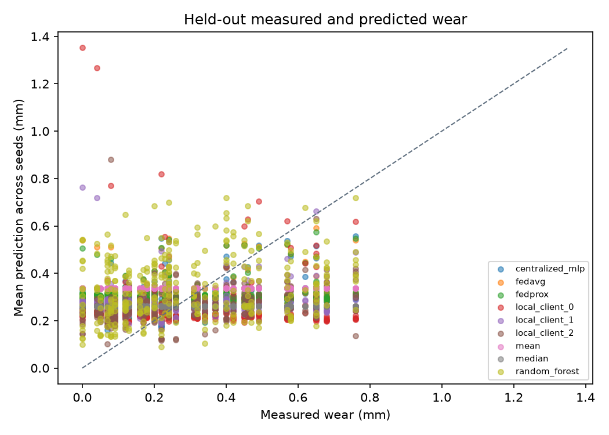
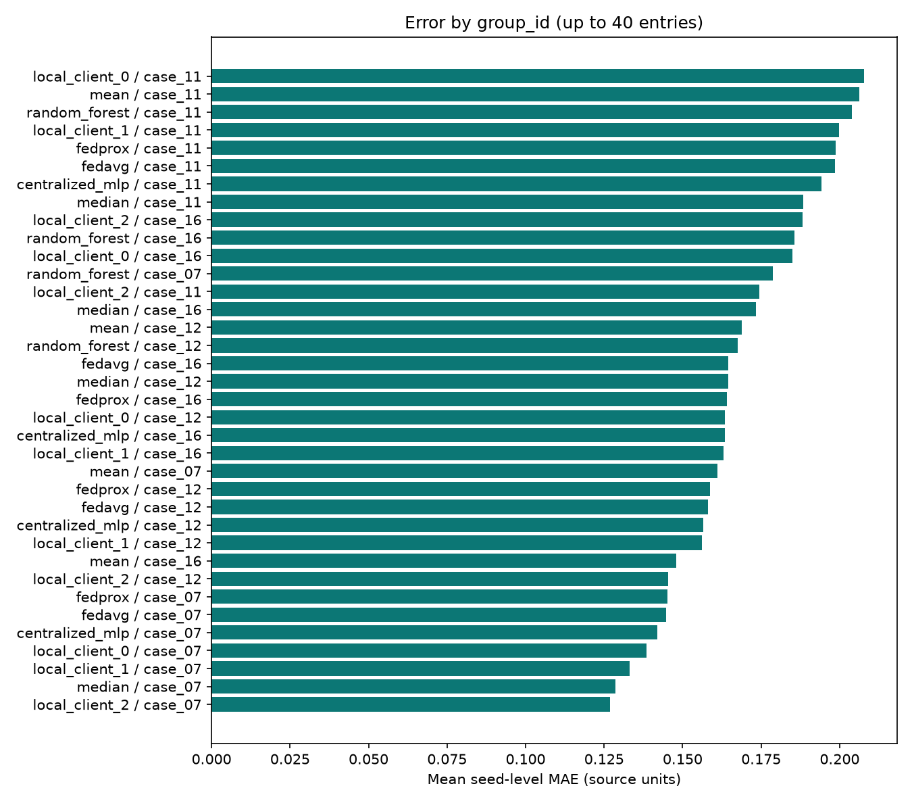
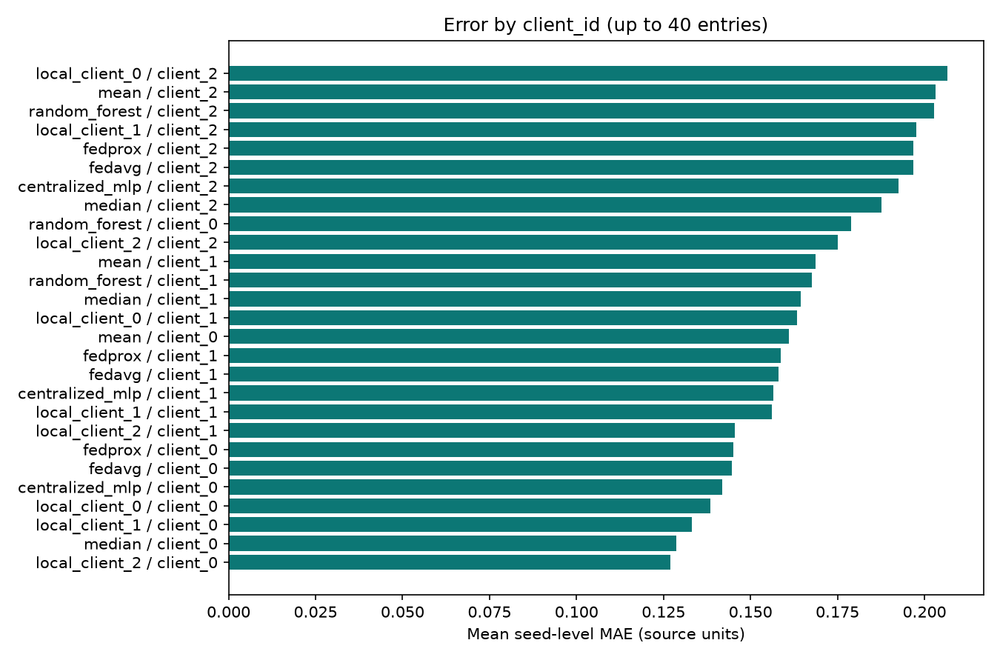
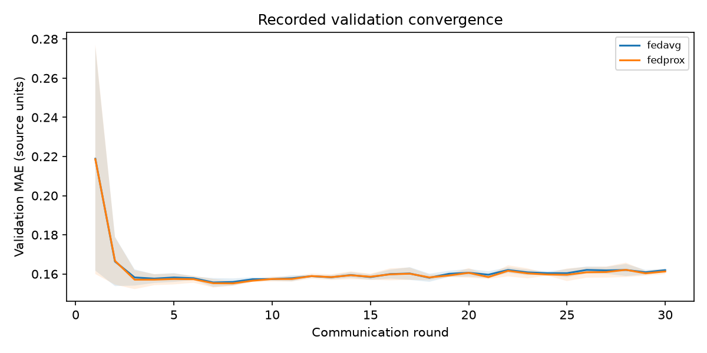

# FabFederate-CNC experiment report

Artifact directory: `nasa-final`. Every value and figure below comes from saved CSV artifacts. NASA evaluation is case-heldout; independent physical-tool identity is unverified. Windows are not additional independent machining cases.

## Held-out evaluation across recorded seeds

| method | scenario | split | units | runs | mean_mae | seed_std_mae | mean_rmse | seeds | mean_group_mae |
| --- | --- | --- | --- | --- | --- | --- | --- | --- | --- |
| centralized_mlp | condition | test | mm | 3 | 0.173054 | 0.00349006 | 0.203879 | 3 | 0.164014 |
| centralized_mlp | few_shot | test | mm | 3 | 0.221899 | 0.0299914 | 0.515787 | 3 | 0.191558 |
| centralized_mlp | iid | test | mm | 3 | 0.173054 | 0.00349006 | 0.203879 | 3 | 0.164014 |
| centralized_mlp | label | test | mm | 3 | 0.173054 | 0.00349006 | 0.203879 | 3 | 0.164014 |
| centralized_mlp | quantity | test | mm | 3 | 0.173054 | 0.00349006 | 0.203879 | 3 | 0.164014 |
| fedavg | condition | test | mm | 3 | 0.172988 | 0.00334708 | 0.200559 | 3 | 0.163492 |
| fedavg | few_shot | test | mm | 3 | 0.214184 | 0.017294 | 0.435283 | 3 | 0.187241 |
| fedavg | iid | test | mm | 3 | 0.176218 | 0.00188259 | 0.206747 | 3 | 0.166486 |
| fedavg | label | test | mm | 3 | 0.173561 | 0.00185 | 0.201258 | 3 | 0.163251 |
| fedavg | quantity | test | mm | 3 | 0.175709 | 0.00137858 | 0.204393 | 3 | 0.165435 |
| fedprox | condition | test | mm | 3 | 0.173215 | 0.00353393 | 0.201911 | 3 | 0.163821 |
| fedprox | few_shot | test | mm | 3 | 0.214046 | 0.0170691 | 0.433362 | 3 | 0.187171 |
| fedprox | iid | test | mm | 3 | 0.176529 | 0.00239715 | 0.207135 | 3 | 0.166642 |
| fedprox | label | test | mm | 3 | 0.173789 | 0.00216858 | 0.201504 | 3 | 0.163421 |
| fedprox | quantity | test | mm | 3 | 0.175097 | 0.00468887 | 0.206234 | 3 | 0.1652 |
| local_client_0 | condition | test | mm | 3 | 0.172526 | 0.00455192 | 0.219519 | 3 | 0.163278 |
| local_client_0 | few_shot | test | mm | 3 | 0.176824 | 0.00920866 | 0.254396 | 3 | 0.164342 |
| local_client_0 | iid | test | mm | 3 | 0.18192 | 0.0107441 | 0.245083 | 3 | 0.173676 |
| local_client_0 | label | test | mm | 3 | 0.165555 | 0.00201315 | 0.202059 | 3 | 0.164887 |
| local_client_0 | quantity | test | mm | 3 | 0.174999 | 0.00539695 | 0.234091 | 3 | 0.177018 |
| local_client_1 | condition | test | mm | 3 | 0.160439 | 0.00192619 | 0.194492 | 3 | 0.156237 |
| local_client_1 | few_shot | test | mm | 3 | 0.189478 | 0.0152671 | 0.297475 | 3 | 0.174068 |
| local_client_1 | iid | test | mm | 3 | 0.174145 | 0.001921 | 0.213921 | 3 | 0.162985 |
| local_client_1 | label | test | mm | 3 | 0.176834 | 0.00359776 | 0.229591 | 3 | 0.164595 |
| local_client_1 | quantity | test | mm | 3 | 0.188336 | 0.00248279 | 0.243342 | 3 | 0.174602 |
| local_client_2 | condition | test | mm | 3 | 0.181438 | 0.0118252 | 0.246803 | 3 | 0.174424 |
| local_client_2 | few_shot | test | mm | 3 | 0.228024 | 0.0360991 | 0.612287 | 3 | 0.203166 |
| local_client_2 | iid | test | mm | 3 | 0.157928 | 0.00167118 | 0.194102 | 3 | 0.158727 |
| local_client_2 | label | test | mm | 3 | 0.181438 | 0.0118252 | 0.246803 | 3 | 0.174424 |
| local_client_2 | quantity | test | mm | 3 | 0.175043 | 0.0066018 | 0.208532 | 3 | 0.166398 |
| mean | condition | test | mm | 3 | 0.185673 | 0 | 0.21227 | 3 | 0.171059 |
| mean | few_shot | test | mm | 3 | 0.197289 | 0 | 0.224144 | 3 | 0.178735 |
| mean | iid | test | mm | 3 | 0.185673 | 0 | 0.21227 | 3 | 0.171059 |
| mean | label | test | mm | 3 | 0.185673 | 0 | 0.21227 | 3 | 0.171059 |
| mean | quantity | test | mm | 3 | 0.185673 | 0 | 0.21227 | 3 | 0.171059 |
| median | condition | test | mm | 3 | 0.17047 | 0 | 0.206701 | 3 | 0.163718 |
| median | few_shot | test | mm | 3 | 0.173918 | 0 | 0.205475 | 3 | 0.165301 |
| median | iid | test | mm | 3 | 0.17047 | 0 | 0.206701 | 3 | 0.163718 |
| median | label | test | mm | 3 | 0.17047 | 0 | 0.206701 | 3 | 0.163718 |
| median | quantity | test | mm | 3 | 0.17047 | 0 | 0.206701 | 3 | 0.163718 |
| random_forest | condition | test | mm | 3 | 0.188248 | 0.00174521 | 0.224198 | 3 | 0.183966 |
| random_forest | few_shot | test | mm | 3 | 0.204481 | 0.00497567 | 0.239461 | 3 | 0.198869 |
| random_forest | iid | test | mm | 3 | 0.188248 | 0.00174521 | 0.224198 | 3 | 0.183966 |
| random_forest | label | test | mm | 3 | 0.188248 | 0.00174521 | 0.224198 | 3 | 0.183966 |
| random_forest | quantity | test | mm | 3 | 0.188248 | 0.00174521 | 0.224198 | 3 | 0.183966 |

[Full evaluation summary](evaluation_summary.csv) · [All per-run metrics](../../experiments/nasa-final/metrics.csv) · [All saved predictions](../../experiments/nasa-final/predictions.csv)

Means and standard deviations describe recorded seeds, not independent new cases or calibrated prediction intervals. Single-seed standard deviations are unavailable. Report tables show at most 60 rows; CSV files retain every row.

## Measured versus predicted

Overview: split=test, scenario=iid. Repeated-seed predictions are averaged for the same saved window, preserving dataset, source cut/run, group, window and other recorded provenance. Only the training seed is averaged; this descriptive point estimate is not a separately fitted ensemble. [Exact plotted points and seed counts](../../experiments/nasa-final/overview_predictions.csv).

## Independent-case error

[All case errors, including every seed](../../experiments/nasa-final/group_errors.csv). Overview figures show at most 40 highest-error method/case combinations; each bar averages the recorded seed-level case MAEs. Full CSV coverage is retained.

### Largest recorded window errors in the overview stratum

| method | seed | scenario | split | group_id | window_id | wear_target | prediction | absolute_error |
| --- | --- | --- | --- | --- | --- | --- | --- | --- |
| local_client_0 | 11 | iid | test | case_11 | 0 | 0 | 1.58773 | 1.58773 |
| local_client_0 | 22 | iid | test | case_11 | 0 | 0 | 1.56542 | 1.56542 |
| local_client_0 | 11 | iid | test | case_11 | 0 | 0.04 | 1.48433 | 1.44433 |
| local_client_0 | 22 | iid | test | case_11 | 0 | 0.04 | 1.46546 | 1.42546 |
| local_client_0 | 11 | iid | test | case_07 | 2 | 0.22 | 1.33461 | 1.11461 |
| local_client_2 | 11 | iid | test | case_11 | 0 | 0.08 | 1.1247 | 1.0447 |
| local_client_1 | 11 | iid | test | case_11 | 0 | 0 | 0.969191 | 0.969191 |
| local_client_0 | 11 | iid | test | case_11 | 0 | 0.08 | 1.03246 | 0.95246 |
| local_client_0 | 33 | iid | test | case_11 | 0 | 0 | 0.904918 | 0.904918 |
| local_client_1 | 11 | iid | test | case_11 | 0 | 0.04 | 0.90673 | 0.86673 |

## Convergence

Overview: scenario=iid. Lines show seed means; shading shows one descriptive standard deviation when multiple seeds are present.

## Measured simulation cost

| method | scenario | duration_seconds | upload_bytes | download_bytes |
| --- | --- | --- | --- | --- |
| fedavg | condition | 1.24089 | 1.68228e+06 | 1.68228e+06 |
| fedavg | few_shot | 0.802918 | 1.68228e+06 | 1.68228e+06 |
| fedavg | iid | 3.23885 | 1.68228e+06 | 1.68228e+06 |
| fedavg | label | 1.67102 | 1.68228e+06 | 1.68228e+06 |
| fedavg | quantity | 1.21535 | 1.68228e+06 | 1.68228e+06 |
| fedprox | condition | 1.09775 | 1.68228e+06 | 1.68228e+06 |
| fedprox | few_shot | 0.696875 | 1.68228e+06 | 1.68228e+06 |
| fedprox | iid | 1.60024 | 1.68228e+06 | 1.68228e+06 |
| fedprox | label | 2.60174 | 1.68228e+06 | 1.68228e+06 |
| fedprox | quantity | 1.61949 | 1.68228e+06 | 1.68228e+06 |

[Full cost records by run](cost_by_run.csv). Values above are the mean total per run across recorded seeds. Payload bytes count serialized model updates, not network protocol overhead or production deployment cost.

## Interpretation and limitations

Compare methods only within matched datasets, splits, scenarios and budgets. Recorded outcomes include negative results; no guaranteed federated-learning benefit is established. Missing client-domain errors remain unavailable.

Public-data clients are logical simulation partitions on one computer. Pooled public preprocessing and parameter exchange provide no formal privacy guarantee. SHAP attributions describe the fitted predictor; correlated features and reference choices can change attribution, and attribution is not causation.

Campus validation is unavailable unless a separately documented approved capture and measured-label study has been performed. This is an offline research demonstrator for human review, not a validated inspection threshold or machine-control system.
